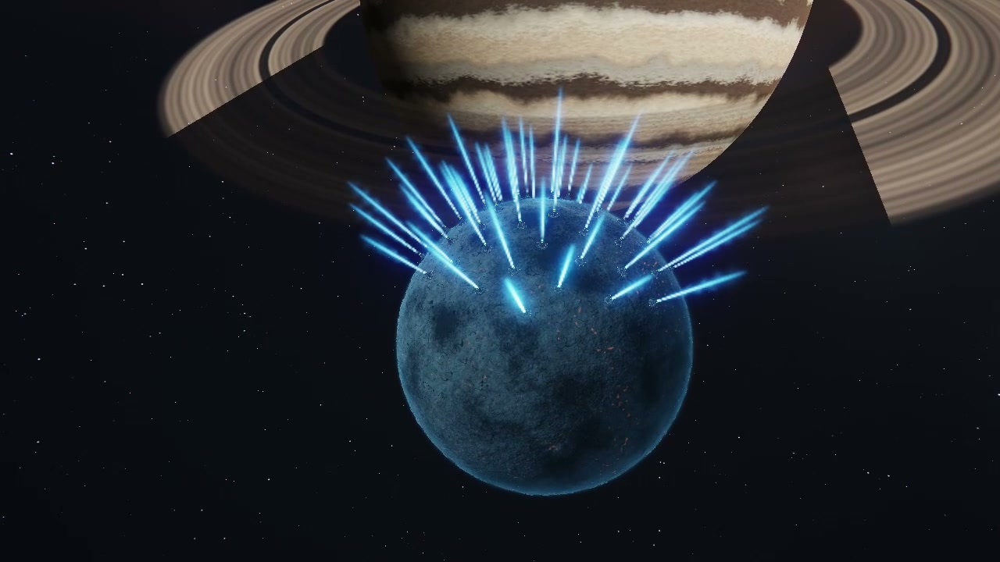
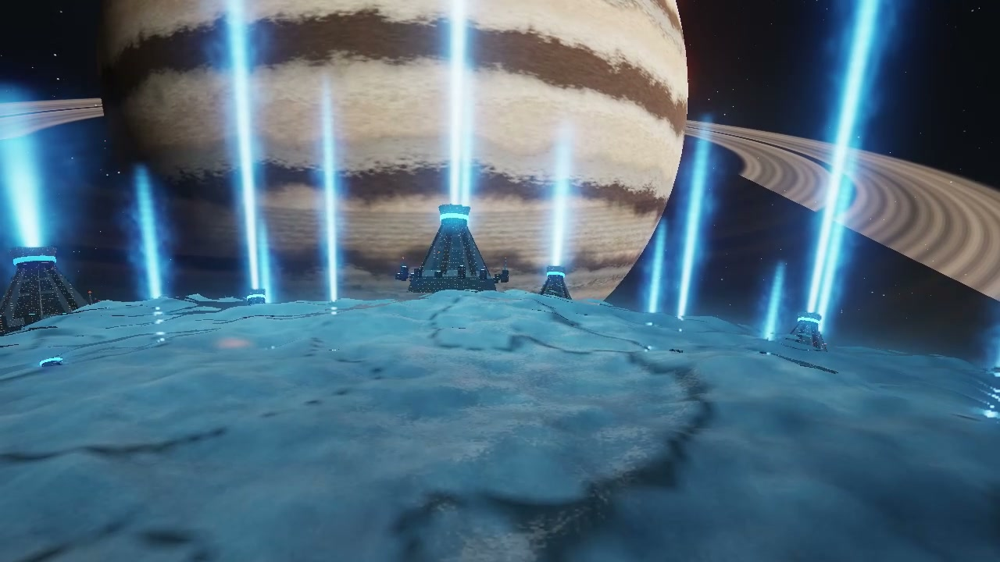

# Eclipse Window · 日蚀窗口

[Open the demo · 在线试玩](https://daoruidu.github.io/eclipse-window/) · [Watch the film · 看成片](https://github.com/daoruidu/eclipse-window/releases/download/v1.0.0/Eclipse-Window.mp4) · [Download HTML · 离线版](https://github.com/daoruidu/eclipse-window/releases/download/v1.0.0/index.html)

The sun slips behind a gas giant. Across the ice, 53 engines begin to fire. The camera pulls back until you can see what they’re moving.

A 42-second browser film in one HTML file (about 65 KiB). WebGL 2 draws the scene and Web Audio synthesizes the score. The file runs offline and loads no external assets.

## Run it

Open the demo or save [`index.html`](index.html) and open it in a browser with WebGL 2. Click **进入日蚀** to start with sound. Use the timeline to jump directly to ignition or the orbital shot.

| Input | Action |
| --- | --- |
| Drag / scroll | Orbit the camera / zoom |
| `Space` / `R` | Pause or resume / restart |
| `M` / `F` / `H` | Toggle sound / fullscreen / hide controls |

## Inside the file

The shaders generate the terrain and the gas giant’s cloud bands when the page opens. The engines share one mesh and are drawn with instancing. Their plumes are composited against the scene’s depth so the planet can hide the engines on its far side.

Everything lives in [`index.html`](index.html). Search for `cameraAt` to edit the flight path or `audioUpdate` to change the score.

## 中文

太阳被巨行星挡住后，冰原上的 53 座引擎陆续点火。镜头从地表一路拉到轨道，最后看到整颗正在离开的行星。

用支持 WebGL 2 的浏览器打开在线版或下载的 HTML，点「进入日蚀」就能连同配乐一起看。拖动可以环绕，滚轮可以缩放，按空格暂停，`R` 重播，`M` 切换声音，`F` 全屏，`H` 隐藏界面。约 42 秒，画面与声音均由浏览器现场生成。
